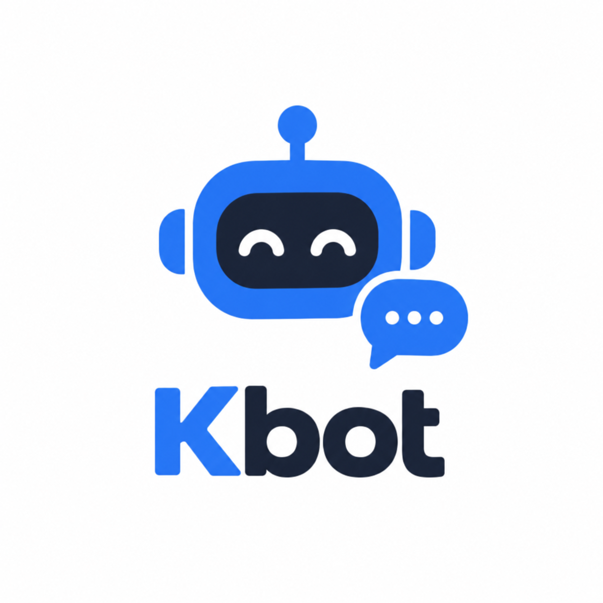
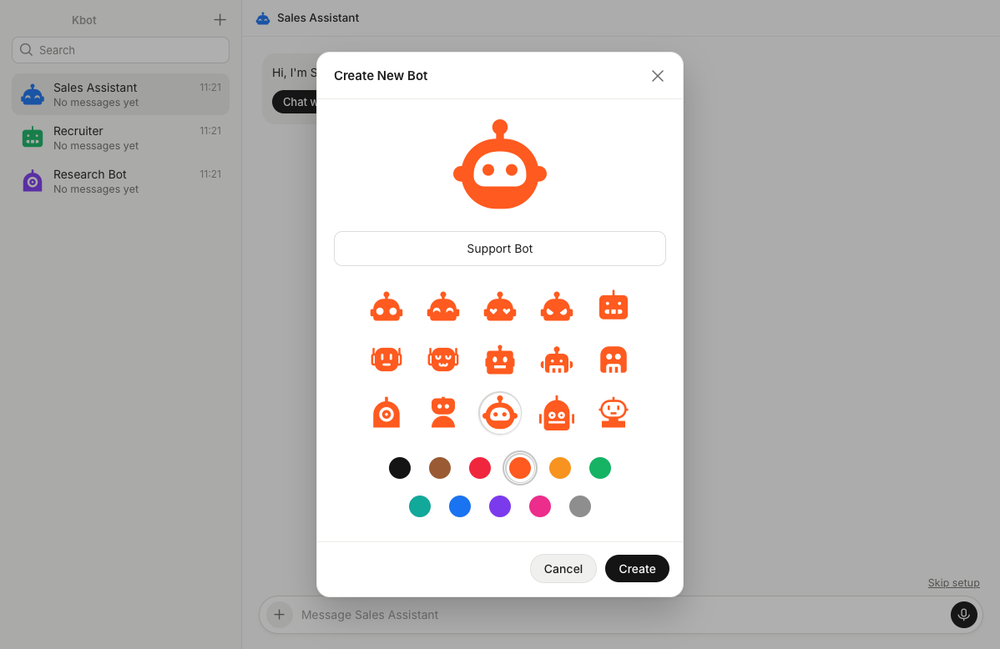
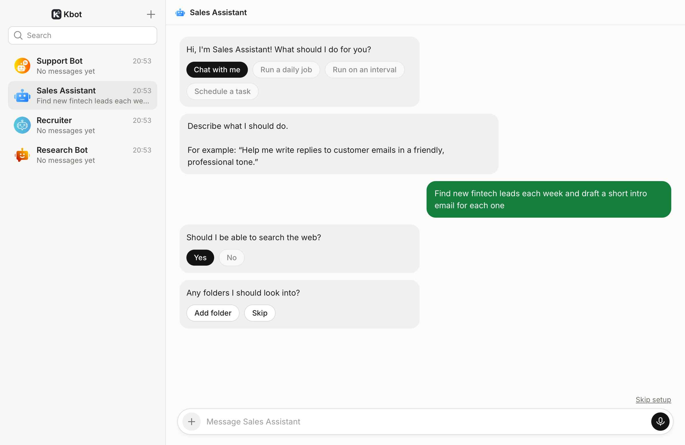
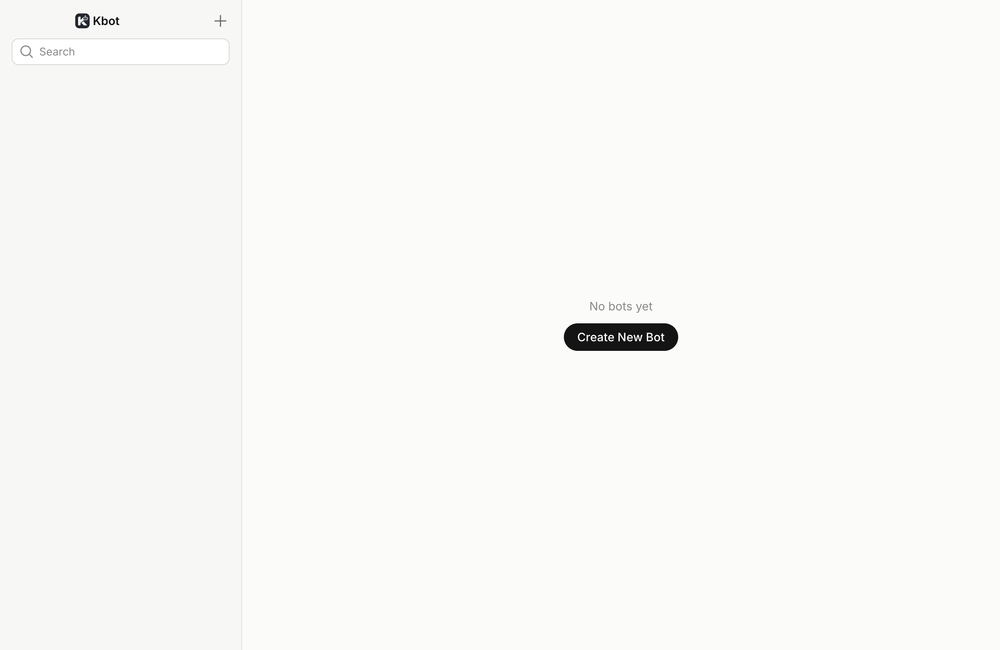

<h1 align="center"></h1>

<p align="center"><b>Don't just chat with AI. Put it to work.</b></p>

<p align="center">
Kbot is more than a chatbot. It lets anyone build <b>personal agents</b> shaped
around their own needs: a sales assistant that finds leads, a recruiter that
screens candidates, a researcher that digs through the web. Each one is yours to
name, style and put to work, right from your desktop.
</p>

| Build your agent | Put it to work |
| --- | --- |
|  |  |

<p align="center"></p>

## Why Kbot

- **Agents, not just answers.** A chatbot tells you what to do; a Kbot agent
  does it. Agents are built to use tools and even take over the computer, and
  hand control back to you whenever you want it.
- **Built around you.** Spin up as many agents as you need, one per job, each
  with its own name, look and conversation history.
- **Your data stays on your machine.** Kbot is a native desktop app. Your
  agents and conversations are stored in a local database on your computer and
  are never stored in the cloud.

Agents run on [Claude Code](https://docs.claude.com/en/docs/claude-code),
using your own Claude subscription. Built with [Tauri 2](https://tauri.app)
(Rust) and React, with all data stored locally in SQLite.

## How it works

- **Setup in the chat.** A new agent asks what it should do: chat with you, or
  run a job daily, on an interval, or as a task on a date. It asks for a
  description, a schedule, whether it may search the web and which folders it
  may read, asks Claude a few clarifying questions, then shows the instructions
  it wrote for itself for you to confirm or edit.
- **`/setup`.** Type it in the chat to see the agent's current setup, then say
  what to change in your own words ("run at 7:00 on weekdays", "turn off web
  search"). Claude updates the setup and shows it to you before saving. On an
  agent that isn't set up yet, `/setup` starts the setup. **Edit** in the
  agent's right-click menu does the same.
- **Scheduled jobs.** A job runs at its set time on the chosen days, every few
  minutes or hours, or as a task on a date (once, or every month on that day;
  on the 29th–31st it runs on the last day of shorter months). It posts the
  result in the chat (with a notification if you want one). Jobs only run while
  Kbot is open; a missed run is not caught up later, except a one-time task,
  which runs as soon as Kbot is open again. A task on a date also has **Run
  now** above its chat.
- **Settings.** Click the agent's name above the chat to change its
  instructions, schedule, web access, folders or model, run the job now, or redo
  the setup.
- **Clear or delete.** Right-click an agent in the sidebar to clear its chat
  history (it also forgets the conversation) or delete it.
- **Full access.** Agents run Claude Code with all its tools and
  `--permission-mode bypassPermissions`: they can run shell commands and read,
  create, change or delete files anywhere your user account can, without
  asking. The folders you give an agent are where it works; they don't limit
  it. Turning web access off removes WebSearch and WebFetch.
- **Questions and approvals.** When Claude Code asks the user something, the
  question shows up in the chat with its options as buttons. If it ever asks
  before using a tool, you get Approve and Deny buttons. The run waits for your
  answer; stopping it, or the run ending, expires the card. A daily job that
  is waiting sends a notification if notifications are on.
- **Working spinner.** A bot that is busy shows a spinner in the sidebar, next
  to its latest message, or the question it's waiting on.

## Getting started

To use Kbot you need a Claude subscription (Pro or Max) and Claude Code
installed and signed in with it:

```bash
curl -fsSL https://claude.ai/install.sh | bash
claude auth login
```

Kbot shows a "Connect Claude" screen until it finds a signed-in `claude`. It
looks for the binary in the usual install locations, then on your `PATH`; set
`KBOT_CLAUDE_BIN` to use a specific one.

To build it you also need [Node.js](https://nodejs.org) 22.6+ and the
[Tauri prerequisites](https://tauri.app/start/prerequisites/) (Rust toolchain
plus your platform's build tools).

```bash
npm install
npm run tauri dev      # run the desktop app with hot reload
npm run tauri build    # build an installable bundle
```

To build the macOS installer (a `.dmg` in `release/`), run `scripts/build.sh`,
or `scripts/build.sh --arch universal` for one that runs on both Apple Silicon
and Intel Macs. See `scripts/build.sh --help` for signing and notarizing.

`npm run dev` runs only the UI in a browser against an in-memory mock backend
(`src/lib/mockBackend.ts`), which is handy for UI work without a Rust build.
Add `?claude=loggedOut` (or `notInstalled`, `notSubscription`) to the URL to see
the Connect Claude screen.

## Project layout

```
src/                     React UI
  lib/api.ts             the only place the UI talks to Rust (commands + events)
  components/            sidebar, chat view, setup cards, settings, "Create New Bot" dialog
src-tauri/
  src/commands.rs        UI -> Rust commands (list_bots, create_bot, send_message, ...)
  src/store.rs           SQLite persistence
  src/migrate.rs         migration runner
  migrations/            SQL migration scripts
  src/claude.rs          finds and runs the Claude Code CLI, parses its stream-json output
  src/agent.rs           one agent turn: builds the prompt, streams the reply into the chat
  src/setup.rs           onboarding state machine
  src/scheduler.rs       scheduled jobs
  src/runs.rs            one run per bot at a time, cancellation
e2e/                     end-to-end tests, fake `claude` CLI, screenshot script
icon.png                 the logo; app icons in src-tauri/icons/ are generated from it
docs/screenshots/        README images
```

## Database and migrations

Bots and messages are stored in `kbot.db` in the OS app-data directory
(e.g. `~/Library/Application Support/com.keytechx.kbot/` on macOS).

Every `.sql` file in `src-tauri/migrations/` is compiled into the app.
On each launch, pending migrations run in order, each in its own
transaction, and are recorded in the `schema_migrations` table. A fresh install
creates the whole schema on first launch; existing installs upgrade when they
open a newer version.

To change the schema, add a new file with the next number:

```
src-tauri/migrations/0003_add_bot_tags.sql
```

Never edit a migration that has already shipped. The build fails on a badly
named file or a duplicate version number.

## Testing

```bash
cd src-tauri && cargo test   # store, setup, scheduler and stream parser unit tests
npm run test:e2e             # end-to-end tests against the real app
```

The end-to-end tests build the app with the `e2e` cargo feature, which embeds a
WebDriver server
([tauri-plugin-wdio-webdriver](https://crates.io/crates/tauri-plugin-wdio-webdriver)),
then drive the real window with [WebdriverIO](https://webdriver.io) against a
throwaway data directory (`KBOT_DATA_DIR`, deleted afterwards), so they never
touch your real agents; an e2e build refuses to start without it. Claude Code is replaced by `e2e/fake-claude.ts` (through
`KBOT_CLAUDE_BIN`), so the tests need no account and use no quota. That feature
is never enabled in normal builds. If the app
is already built, run just the tests with `node --test --test-concurrency=1 "e2e/**/*.test.ts"`.

To regenerate the screenshots above: `npm run screenshots`.

## License

Kbot is released under the [MIT License](LICENSE).

See [THIRD_PARTY_NOTICES.md](THIRD_PARTY_NOTICES.md) for the bot icon sets and
their licenses.
